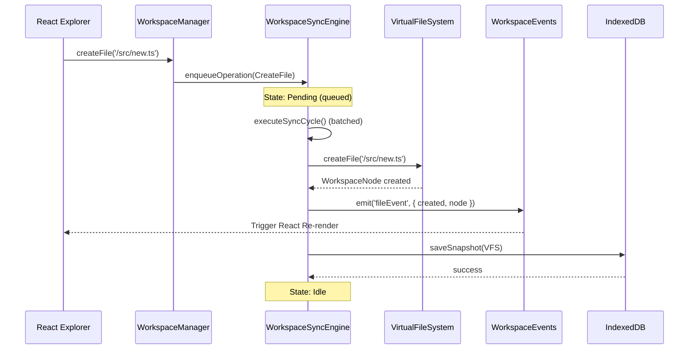
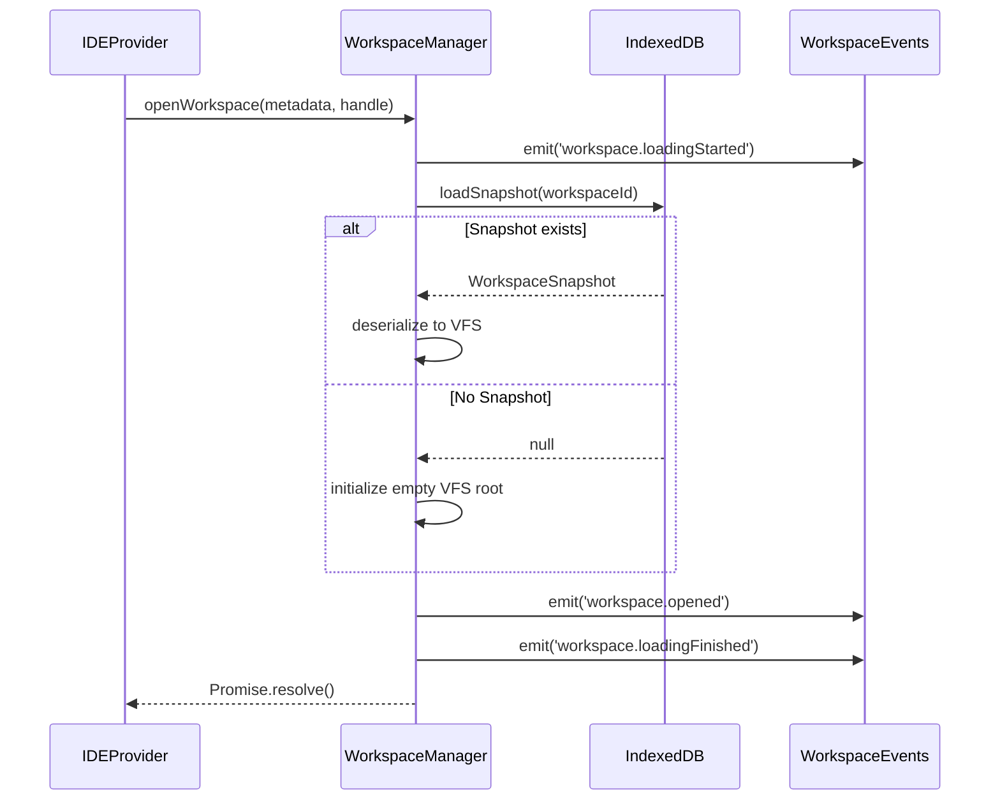
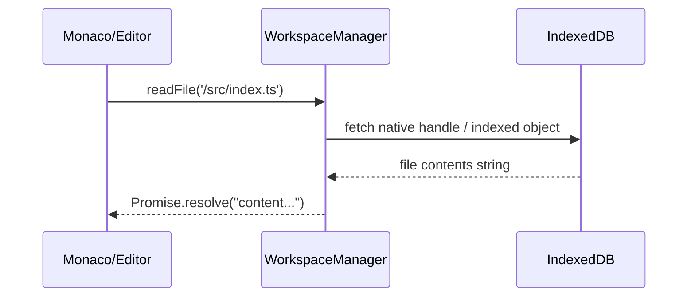
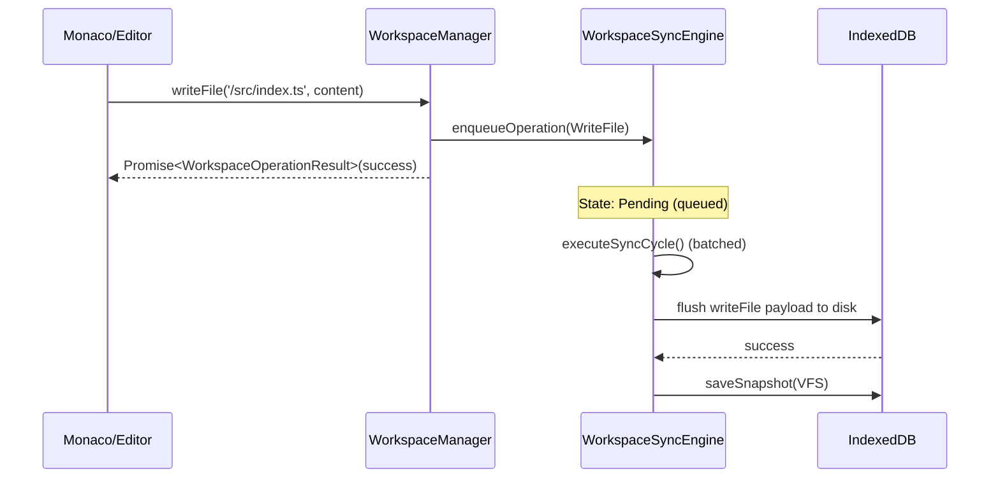
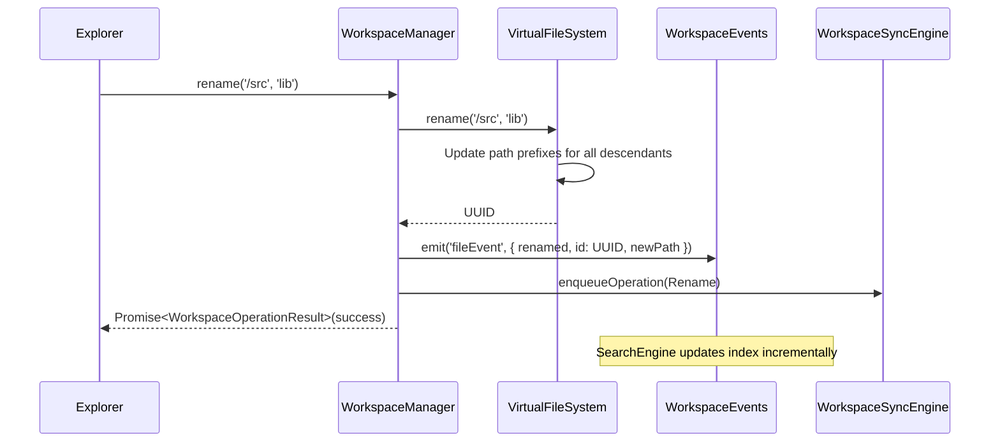
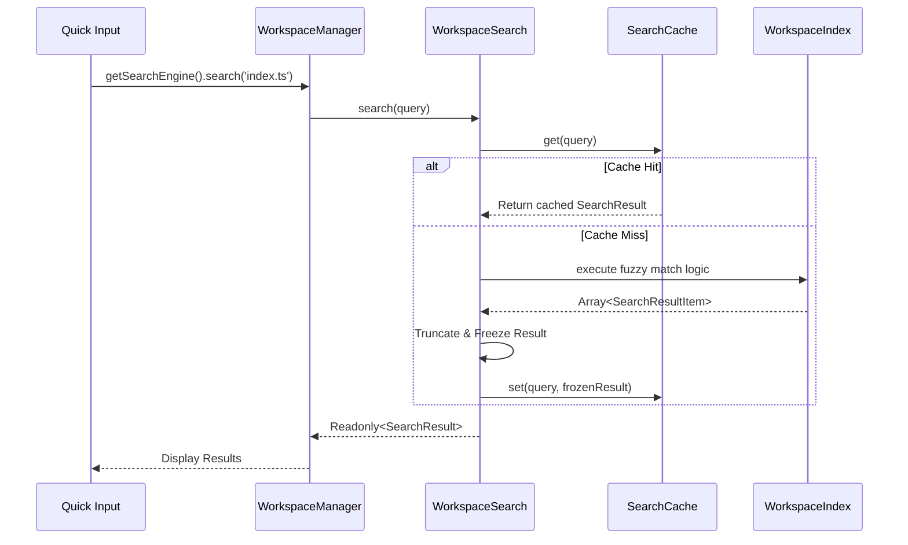

# Architecture Sequence Diagrams

This document contains Mermaid sequence diagrams detailing the critical workflows of the Workspace Engine.

## 1. File Creation & Synchronization Flow

When a user creates a new file via the UI, the operation flows downward without immediate local VFS mutation until the Sync Engine processes the batch.

## 2. Workspace Open Flow

## 3. Open File Flow

## 4. Save File Flow

## 5. Rename Folder Flow

## 6. Fast Fuzzy Search Query Flow

