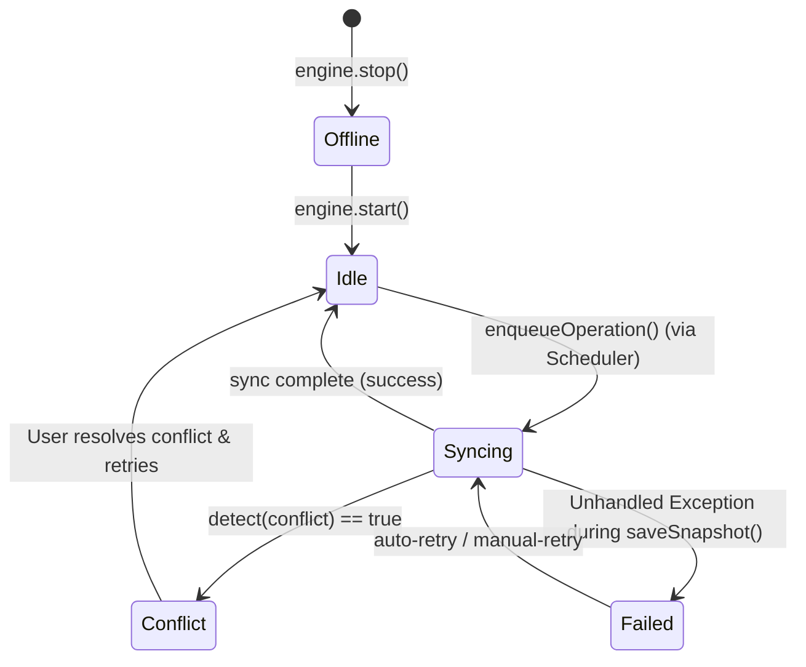
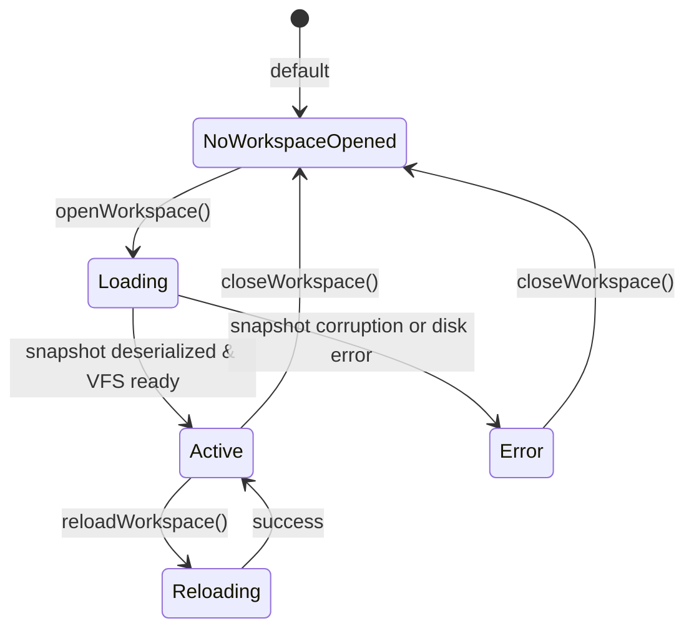

# Architecture State Machines

This document illustrates the internal state machines of the primary managers and engines within the Workspace system.

## WorkspaceSyncEngine State Machine

The sync engine handles transitions automatically via `WorkspaceSyncState.ts`.

## WorkspaceManager State Machine

Represents the high-level `WorkspaceState` exposed to the React UI provider (`IDEProvider.tsx`).

